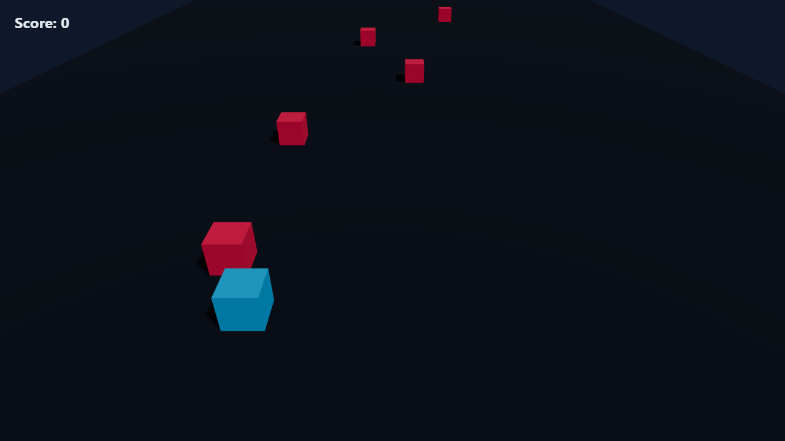
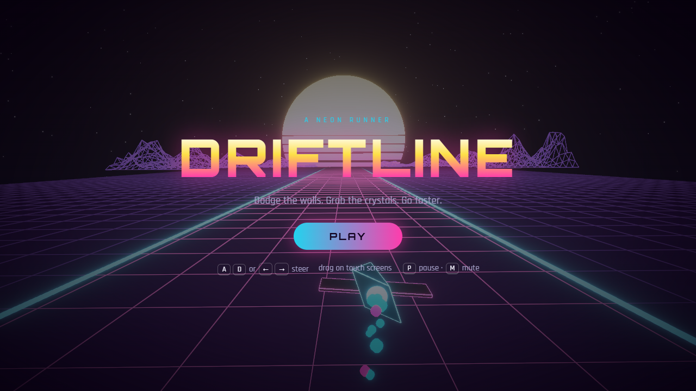

# Driftline — a neon runner

A synthwave endless runner and shooter built with **React Three Fiber**. Steer your ship down a
glowing grid, thread through walls, blast enemy swarms, power up your weapon and take down the
Sentinel boss — all while the speed keeps climbing.

**▶ [Play it live](https://nuhregaibunsal.github.io/driftline/)** — works on desktop and mobile.

<p align="center">
  
  
</p>

## Features

- **Synthwave world** — scrolling neon grid (custom GLSL shader), striped retro sun, wireframe mountains, starfield and bloom post-processing
- **Speed ramp** — the track accelerates over time and obstacle patterns get tighter
- **Obstacle patterns** — pillars, double pillars, walls with a single gap and slaloms
- **Auto-fire combat** — five weapon levels (single → twin → spread → quad → 5-way fan); walls absorb bullets
- **Enemies** — swaying drones, divers that home in on you, and armoured tanks that take a beating
- **Sentinel boss** — arrives at 40 s and roughly every minute after, with a health bar, aimed spread shots and an enraged second phase
- **Power-ups** dropped by enemies — weapon +1, rapid fire, shield bubble and extra life; getting hit costs a weapon level
- **Crystals & combo** — every 5 crystals in a row raise the multiplier (up to ×5); getting hit resets it
- **3 lives** with invulnerability frames, camera shake and particle explosions
- **Juice** — ship banking, engine exhaust particles, speed-based FOV, synthesized sound effects (Web Audio, no asset files)
- **Best score** saved locally, pause on tab switch, touch/drag steering on phones

## Controls

| Action | Keyboard | Touch |
|---|---|---|
| Steer | `A` / `D` or `←` / `→` | drag left/right |
| Start / restart | `Space` or `Enter` | tap **Play** |
| Pause | `P` or `Esc` | ❚❚ button |
| Mute | `M` | 🔊 button |

## Tech stack

- React 18 + Vite
- three.js + @react-three/fiber + @react-three/drei
- @react-three/postprocessing (bloom, vignette)
- GitHub Actions → GitHub Pages deployment

## Run locally

```bash
npm install
npm run dev
```

Then open the printed local URL (default: http://localhost:5173/driftline/).

## Project structure

```
src/
├── App.jsx          # phases (menu / playing / paused / over), input, canvas + effects
├── Hud.jsx          # score, multiplier, lives, speed bar and overlay screens
├── index.css        # HUD and menu styling
└── game/
    ├── state.js     # tuning constants and the mutable per-frame game state
    ├── World.jsx    # game loop, ship, obstacles, crystals, particles, environment shaders
    └── audio.js     # synthesized sound effects
```

Built as part of the i2i Academy Three.js assignment.
